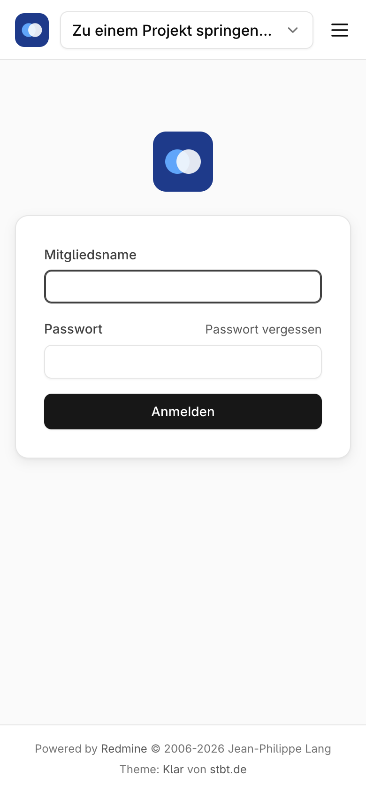
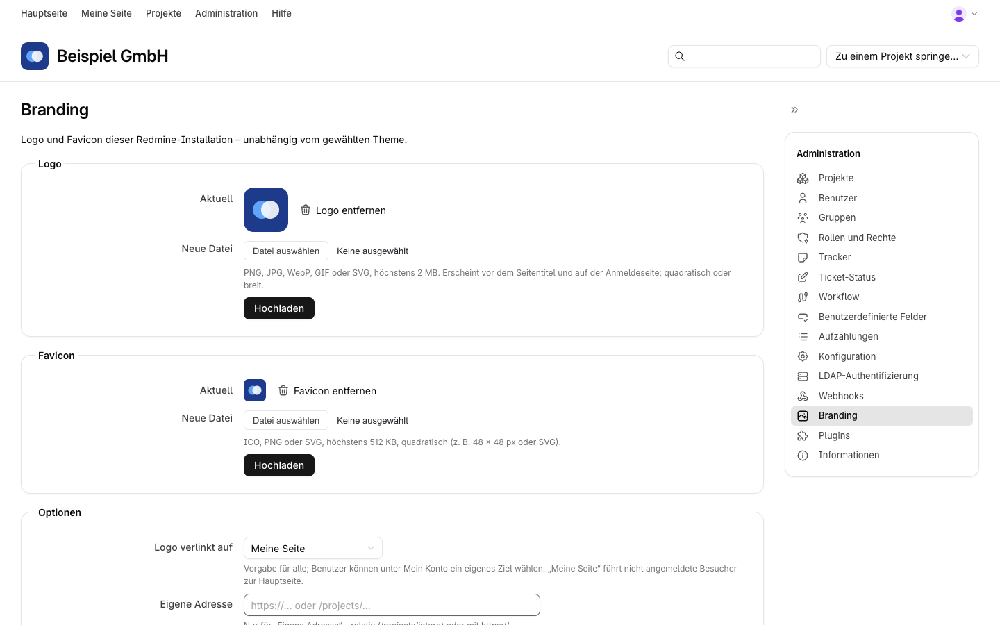

# Branding – logo and favicon for Redmine

Redmine has no setting for a logo, and the favicon only comes from the theme. This
plugin adds both – managed under *Administration → Branding*, without server access and
independent of the selected theme:

- **Logo in the header** before the page title; on mobile before the project selector.
- **Logo link** – where the logo points to (home, my page, projects or a custom
  address), as a default for everyone and, if they like, per user under *My account*.
- **Logo on the login page** above the form (can be switched off).
- **Favicon** – replaces the theme's favicon.

Tested with Redmine's themes Default, Alternate and Classic, and with
[Klar](https://github.com/stbt-de/redmine-klar-theme), which styles the logo itself.

## Screenshots

*Shown with the [Klar theme](https://github.com/stbt-de/redmine-klar-theme) and example data.*

Logo in the header:


| Login page | Login page on mobile |
| --- | --- |
|  |  |

Settings under *Administration → Branding*:



## Installation

The folder in `plugins/` must be named `redmine_branding`.

**Release zip:** download `redmine-branding-v*.zip` from the
[releases](https://github.com/stbt-de/redmine-branding/releases) and unpack it in the
`plugins/` directory (it contains the folder `redmine_branding/`).

**Or clone:**

```
cd /path/to/redmine/plugins
git clone https://github.com/stbt-de/redmine-branding.git redmine_branding
```

Restart Redmine. No database migration is needed.

Then, under *Administration → Branding*:

| | Formats | Size |
| --- | --- | --- |
| Logo | PNG, JPG, WebP, GIF, SVG | up to 2 MB, square or wide |
| Favicon | ICO, PNG, SVG | up to 512 KB, square |

Logo link: default "My page" (anonymous visitors go to the home page). A custom
address may be relative to the installation (`/projects/internal`) or start with
`https://`. Users can pick home, my page, projects or a custom address of their own
in their preferences (*My account*); without a valid address the default applies.

The interface is available in English and German.

### Tested with

| Redmine | Ruby | Rails | Checked |
| --- | --- | --- | --- |
| 7.0.3 | 4.0.10 | 8.1.4 | integration tests; in the browser with the themes Default, Alternate, Classic and Klar (desktop, mobile, login page) |
| 6.1.6 | 3.4.13 | 7.2.4 | integration tests; in the browser with the same themes |
| 6.0.12 | 3.3.14 | 7.2.3.2 | integration tests |

The plugin requires Redmine 6.0 or later.

## How it works

- Files are stored in Redmine's files directory (`files/redmine_branding/`) and are
  therefore backed up together with attachments. Their description (file name, type,
  checksum) is kept in the plugin settings.
- They are served at `/branding/logo` and `/branding/favicon` – publicly, because both
  are needed on the login page. With the checksum in the URL, browsers may cache them
  for a long time; a new file gets a new URL.
- The file type is detected from the content, not the name. SVG files are served with
  `Content-Security-Policy: sandbox`, so embedded scripts do not run.
- The favicon replaces Redmine's own favicon tag (no second tag next to it).
- The user preference is stored like Redmine's own preferences.

### For theme authors

Every page names the logo and its link target in meta tags:

```html
<meta name="branding-logo-link" content="/my/page" data-label="My page">
<meta name="branding-logo" content="/branding/logo?v=…">
```

`branding-logo-link` is always present, `branding-logo` only when a logo has been
uploaded. `branding.js` inserts the logo as `a.branding-logo` into the header. A theme
that wants to render the logo itself sets, when its script loads,

```js
document.documentElement.setAttribute('data-branding-logo', 'theme');
```

– the plugin then inserts nothing and the theme reads the meta tags. The login page
logo (`.branding-login-logo`) is always rendered by the plugin; its base styles are
wrapped in `:where()` so themes can override them without a specificity fight.

## Development

Tests run against a fresh Redmine in a container (Docker required):

```bash
dev/run-tests.sh                        # Redmine 7.0
REDMINE_VERSION=6.1 dev/run-tests.sh    # another version
```

Code comments are written in German.

## Built with AI assistance

This plugin was developed together with an AI coding assistant (Claude Code by
Anthropic). Most of the code was written by the assistant; the direction, design
decisions and review came from [stbt.de](https://stbt.de/). Every feature is covered by
integration tests and was checked in a running Redmine with the themes listed above.

## License

MIT, see [`LICENSE`](LICENSE).
